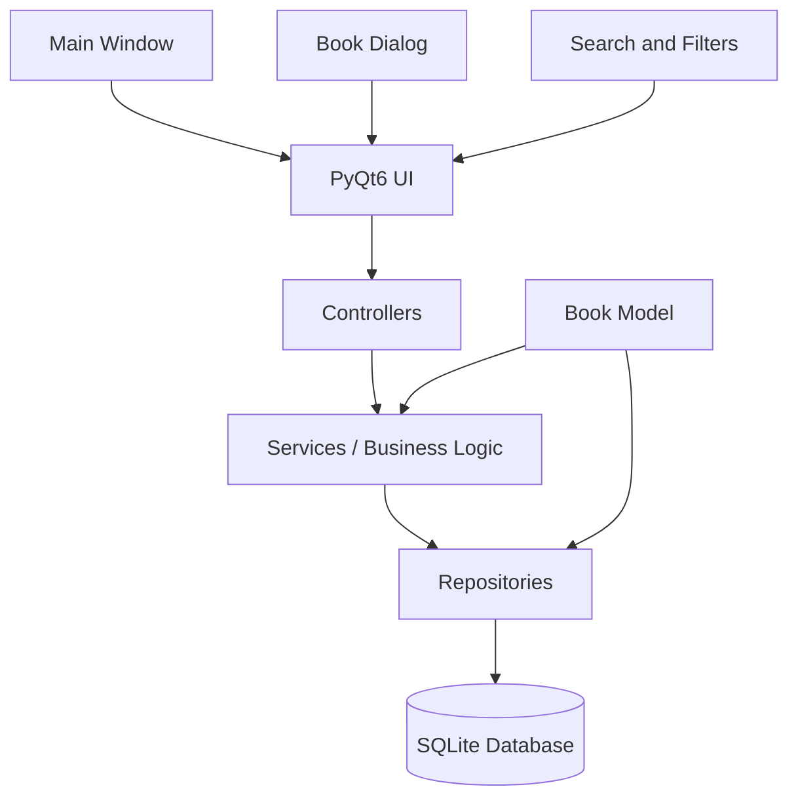

# MyBookShelf — Specification-Driven Development (SDD)

**Project type:** Desktop GUI application  
**Language:** Python 3.12+  
**GUI framework:** PyQt6  
**Database:** SQLite 3  
**Architecture:** Layered architecture with MVC-inspired separation  
**Testing:** pytest  
**Packaging:** PyInstaller  
**Initial platforms:** Windows and Linux  
**Status:** Initial specification

---

## 1. Project Overview

MyBookShelf is a local-first desktop application for cataloging, organizing, searching, and tracking a personal book collection.

The application stores its data locally in SQLite and provides a graphical interface built with PyQt6. It should be useful as a simple personal library manager while remaining extensible enough to support future features such as book covers, shelves, reading statistics, and ISBN lookup.

### 1.1 Goals

- Catalog books with bibliographic and personal information.
- Create, view, edit, and delete book records.
- Search, sort, and filter the collection.
- Track reading status and personal ratings.
- Persist data between application sessions.
- Work without an internet connection.
- Maintain a clear separation between GUI, business logic, and database access.
- Be testable and maintainable.
- Support future enhancements without requiring a major rewrite.

### 1.2 Out of Scope for Version 1

The following are not required for the initial release:

- Online ISBN lookup
- Automatic cover downloads
- Barcode scanning
- Cloud synchronization
- User accounts
- Multiple library users
- E-book reading
- Reading goals and statistics dashboards
- Multiple physical copies per title
- Advanced recommendation features

These may be considered for later versions.

---

## 2. Technology Stack

| Concern | Technology |
|---|---|
| Language | Python 3.12+ |
| GUI | PyQt6 |
| Database | SQLite 3 |
| Database access | Python `sqlite3` |
| Data model | Python dataclasses or regular model classes |
| Architecture | Layered / MVC-inspired |
| Automated tests | pytest |
| GUI tests | pytest-qt, if needed |
| Packaging | PyInstaller |
| Configuration | Python configuration module; optional JSON settings later |

### 2.1 Dependencies

Initial `requirements.txt`:

```text
PyQt6
pytest
pytest-qt
```

`pytest-qt` may be added when GUI-level automated tests are introduced.

---

## 3. Users and Main Use Cases

### 3.1 Primary User

A single person managing their own book collection on a desktop computer.

### 3.2 Main Use Cases

1. Add a book to the collection.
2. View the complete collection.
3. Open a book's details.
4. Edit a book's information.
5. Remove a book from the collection.
6. Search for a book by title, author, ISBN, or publisher.
7. Filter books by genre, reading status, rating, or publication year.
8. Sort the collection.
9. Mark a book as currently being read or completed.
10. Add personal notes and a rating.
11. View basic collection totals.

---

## 4. Functional Requirements

### FR-001 — Add Book

The application shall allow the user to create a new book record.

- Title is required.
- Author is required.
- Other fields are optional unless stated otherwise.
- The application shall validate user input before saving.
- The application shall assign an ID automatically.
- The application shall assign the date-added timestamp automatically.
- After successful creation, the new book shall appear in the collection.

### FR-002 — View Books

The application shall display the collection in a table.

The table shall show at least:

- Title
- Author
- Genre
- Publication year
- Reading status
- Rating

The user shall be able to select a row and view the full book details.

### FR-003 — Edit Book

The application shall allow the user to edit an existing book.

- The edit dialog shall be populated with the current values.
- Saving shall update the existing database record.
- Editing shall not create a duplicate record.
- Canceling shall discard unsaved changes.

### FR-004 — Delete Book

The application shall allow the user to delete a book.

- The application shall ask for confirmation before deletion.
- Canceling confirmation shall leave the record unchanged.
- Confirming deletion shall remove the record from the database and refresh the GUI.
- The application shall handle database errors without crashing.

### FR-005 — Search

The application shall provide a search field.

Search shall support:

- Title
- Author
- ISBN
- Publisher

Search shall be case-insensitive where supported by SQLite's text behavior. Search input shall be treated as data, not executable SQL.

### FR-006 — Filtering

The user shall be able to filter by:

- Genre
- Reading status
- Rating
- Publication year

Filters shall be combinable with search.

The user shall be able to clear all filters.

### FR-007 — Sorting

The user shall be able to sort the collection by:

- Title
- Author
- Publication year
- Rating
- Date added

Sorting shall be performed safely. User-provided column names shall not be inserted directly into SQL without validation against an allowlist.

### FR-008 — Reading Status

Each book shall have one of the following statuses:

- `To Read`
- `Reading`
- `Completed`
- `On Hold`
- `Abandoned`

The user shall be able to change a book's status through the edit dialog or book details view.

### FR-009 — Rating

A book may have a personal rating from 1 to 5.

- Rating may be empty.
- Values outside the allowed range shall be rejected.
- The GUI may display ratings as numbers or stars.

### FR-010 — Personal Notes

The user shall be able to store free-form personal notes for each book.

### FR-011 — Persistence

The application shall:

- Create the database automatically on first launch.
- Preserve records after application restart.
- Use transactions for multi-step database changes.
- Use parameterized SQL queries.
- Handle database errors gracefully.
- Store the database in an appropriate per-user application data directory.

### FR-012 — Collection Summary

The main window shall display at least:

- Total number of books
- Number of books currently being read
- Number of completed books

These values shall update when the collection changes.

---

## 5. Book Data Model

### 5.1 Book Fields

| Field | Python type | Database type | Required | Description |
|---|---|---|---|---|
| `id` | `int` | INTEGER | Automatic | Unique record identifier |
| `title` | `str` | TEXT | Yes | Book title |
| `author` | `str` | TEXT | Yes | Primary author |
| `isbn` | `str \| None` | TEXT | No | ISBN-10 or ISBN-13 |
| `publisher` | `str \| None` | TEXT | No | Publisher |
| `publication_year` | `int \| None` | INTEGER | No | Publication year |
| `genre` | `str \| None` | TEXT | No | Genre or category |
| `language` | `str \| None` | TEXT | No | Book language |
| `description` | `str \| None` | TEXT | No | Description or synopsis |
| `page_count` | `int \| None` | INTEGER | No | Number of pages |
| `rating` | `int \| None` | INTEGER | No | Personal rating from 1 to 5 |
| `status` | `str` | TEXT | Yes | Reading status |
| `date_added` | `str` | TEXT | Automatic | Record creation timestamp |
| `date_finished` | `str \| None` | TEXT | No | Date completed |
| `notes` | `str \| None` | TEXT | No | Personal notes |

### 5.2 Data Validation Rules

- Title must not be empty after trimming whitespace.
- Author must not be empty after trimming whitespace.
- Publication year must be a plausible positive year when supplied.
- Page count must be a positive integer when supplied.
- Rating must be between 1 and 5, inclusive, or empty.
- ISBN shall be stored as text to preserve leading zeros and formatting.
- Status must be one of the defined status values.
- Optional text fields may be stored as `NULL` or normalized empty values consistently.
- Date values shall use ISO 8601 format.

---

## 6. Database Specification

### 6.1 Database File

Default database filename:

```text
bookshelf.db
```

The database shall be stored in a per-user application data directory rather than relying on the current working directory.

The exact path shall be defined in `app/config.py`.

### 6.2 Initial Schema

```sql
CREATE TABLE IF NOT EXISTS books (
    id INTEGER PRIMARY KEY AUTOINCREMENT,

    title TEXT NOT NULL,
    author TEXT NOT NULL,

    isbn TEXT,
    publisher TEXT,
    publication_year INTEGER,
    genre TEXT,
    language TEXT,

    description TEXT,
    page_count INTEGER,

    rating INTEGER
        CHECK (rating IS NULL OR rating BETWEEN 1 AND 5),

    status TEXT NOT NULL DEFAULT 'To Read'
        CHECK (status IN (
            'To Read',
            'Reading',
            'Completed',
            'On Hold',
            'Abandoned'
        )),

    date_added TEXT NOT NULL DEFAULT CURRENT_TIMESTAMP,
    date_finished TEXT,

    notes TEXT,

    CHECK (
        publication_year IS NULL
        OR publication_year > 0
    ),

    CHECK (
        page_count IS NULL
        OR page_count > 0
    )
);
```

### 6.3 Indexes

```sql
CREATE INDEX IF NOT EXISTS idx_books_title
ON books(title);

CREATE INDEX IF NOT EXISTS idx_books_author
ON books(author);

CREATE INDEX IF NOT EXISTS idx_books_status
ON books(status);

CREATE INDEX IF NOT EXISTS idx_books_genre
ON books(genre);

CREATE INDEX IF NOT EXISTS idx_books_isbn
ON books(isbn);
```

### 6.4 Database Access Rules

- All SQL shall be executed through the repository layer.
- All values shall be passed using parameterized queries.
- Database connections shall be managed centrally.
- Database operations that modify data shall use transactions where appropriate.
- The application shall not create a new connection for every individual SQL statement without a defined reason.
- SQLite errors shall be caught at appropriate application boundaries and converted into user-friendly messages.
- The database schema shall be versioned so future changes can be applied through migrations.

---

## 7. User Interface Specification

### 7.1 Main Window

The main window shall contain:

1. Application menu or toolbar
2. Navigation sidebar
3. Search and filter controls
4. Main book table
5. Collection summary/status bar

Suggested layout:

```text
+-------------------------------------------------------------+
| MyBookShelf                         File   Help             |
+-------------------------------------------------------------+
| Sidebar       | Search books...       [Add Book]            |
|               | Genre [All] Status [All] Rating [All]       |
| All Books     +---------------------------------------------+
| To Read       | Title       Author       Genre   Status     |
| Reading       | ------------------------------------------- |
| Completed     | Example     Author       Fiction To Read    |
| On Hold       | Example 2   Author 2     History Completed  |
| Abandoned     |                                             |
|               |                                             |
+---------------+---------------------------------------------+
| Total: 120 | Reading: 4 | Completed: 32                     |
+-------------------------------------------------------------+
```

### 7.2 Navigation Sidebar

The sidebar shall provide:

- All Books
- To Read
- Reading
- Completed
- On Hold
- Abandoned

A genre navigation section may be added when genre handling is implemented.

### 7.3 Toolbar

The toolbar shall provide:

- Search field
- Add Book button
- Edit Book button
- Delete Book button
- Clear filters button

Edit and Delete shall be disabled when no book is selected.

### 7.4 Book Table

The table shall:

- Display the required book columns.
- Support sorting.
- Support row selection.
- Use single-row selection initially.
- Open book details on double-click.
- Refresh after create, update, or delete operations.
- Display a helpful empty-state message when no books match the current search or filters.

### 7.5 Book Dialog

The Add/Edit Book dialog shall contain:

- Title input
- Author input
- ISBN input
- Publisher input
- Publication year input
- Genre input or selector
- Language input
- Page count input
- Rating selector
- Reading status selector
- Description text area
- Date finished input
- Personal notes text area
- Save button
- Cancel button

The dialog shall validate required fields and display validation errors near the relevant input or in a clear message.

### 7.6 Book Details View

The details view shall display all available book information.

It shall provide actions to:

- Edit the book
- Change reading status
- Close the details view

---

## 8. Architecture

The application shall use a layered architecture inspired by MVC.



### 8.1 Model Layer

Responsibilities:

- Represent book data.
- Define data types.
- Provide simple model-level behavior where appropriate.

The model shall not depend on PyQt6 widgets or database connections.

### 8.2 Repository Layer

Responsibilities:

- Execute SQL queries.
- Create, read, update, and delete records.
- Map database rows to model objects.
- Provide search, filtering, sorting, and summary queries.
- Handle low-level database operations.

### 8.3 Service Layer

Responsibilities:

- Validate book data.
- Apply business rules.
- Coordinate repository operations.
- Provide application-level operations to controllers.

### 8.4 Controller Layer

Responsibilities:

- Connect UI events to service methods.
- Update the UI with results.
- Handle application-level errors.
- Keep business logic out of UI widgets.

### 8.5 UI Layer

Responsibilities:

- Display data.
- Collect user input.
- Present validation and error messages.
- Emit user actions through signals or callbacks.

The UI shall not execute SQL directly.

---

## 9. Proposed Project Structure

```text
mybookshelf/
├── README.md
├── SPEC.md
├── requirements.txt
├── main.py
│
├── app/
│   ├── __init__.py
│   ├── config.py
│   │
│   ├── models/
│   │   ├── __init__.py
│   │   └── book.py
│   │
│   ├── database/
│   │   ├── __init__.py
│   │   ├── connection.py
│   │   ├── schema.py
│   │   └── migrations.py
│   │
│   ├── repositories/
│   │   ├── __init__.py
│   │   └── book_repository.py
│   │
│   ├── services/
│   │   ├── __init__.py
│   │   └── book_service.py
│   │
│   ├── controllers/
│   │   ├── __init__.py
│   │   └── book_controller.py
│   │
│   └── ui/
│       ├── __init__.py
│       ├── main_window.py
│       ├── book_dialog.py
│       ├── book_details_dialog.py
│       └── book_table_model.py
│
├── tests/
│   ├── conftest.py
│   ├── test_book_model.py
│   ├── test_book_repository.py
│   ├── test_book_service.py
│   └── test_book_dialog.py
│
└── assets/
    ├── icons/
    └── styles/
```

---

## 10. Non-Functional Requirements

| ID | Requirement |
|---|---|
| NFR-001 | The application shall work offline. |
| NFR-002 | The application shall support at least 10,000 book records. |
| NFR-003 | Common searches should complete within 500 ms for 10,000 records on a typical desktop. |
| NFR-004 | Invalid input shall not crash the application. |
| NFR-005 | Normal database operations shall not make the GUI unresponsive. |
| NFR-006 | GUI, business logic, and database code shall remain separated. |
| NFR-007 | The application shall handle Unicode text. |
| NFR-008 | The initial release shall support Windows and Linux. |
| NFR-009 | The application shall provide readable error messages. |
| NFR-010 | Database schema changes shall be versioned. |

---

## 11. Acceptance Criteria

### Book CRUD

- [ ] AC-001: The application launches successfully.
- [ ] AC-002: The database is initialized automatically.
- [ ] AC-003: A user can add a book with a title and author.
- [ ] AC-004: A user can view a saved book.
- [ ] AC-005: A user can edit a book without creating a duplicate.
- [ ] AC-006: A user can delete a book after confirmation.
- [ ] AC-007: Canceling deletion leaves the book unchanged.
- [ ] AC-008: Book data persists after restarting the application.

### Search and Filtering

- [ ] AC-009: Search finds books by title.
- [ ] AC-010: Search finds books by author.
- [ ] AC-011: Search supports ISBN and publisher.
- [ ] AC-012: Filters can be combined with search.
- [ ] AC-013: Clearing filters restores the full collection.
- [ ] AC-014: Sorting works for supported columns.

### Validation and Reliability

- [ ] AC-015: Empty title is rejected.
- [ ] AC-016: Empty author is rejected.
- [ ] AC-017: Invalid rating is rejected.
- [ ] AC-018: Invalid year and page count are rejected.
- [ ] AC-019: Database errors are presented without crashing.
- [ ] AC-020: SQL queries use parameterized values.

### Reading Status and Summary

- [ ] AC-021: A user can change reading status.
- [ ] AC-022: The collection summary updates after changes.
- [ ] AC-023: The user can view total, reading, and completed counts.

---

## 12. Testing Strategy

### 12.1 Unit Tests

Test:

- Book model construction.
- Required-field validation.
- Rating validation.
- Publication year validation.
- Page count validation.
- Reading status validation.

### 12.2 Repository Tests

Use a temporary SQLite database for tests.

Test:

- Database initialization.
- Creating a book.
- Retrieving a book by ID.
- Listing all books.
- Updating a book.
- Deleting a book.
- Searching books.
- Filtering books.
- Sorting books.
- Summary queries.
- Handling invalid or missing records.

### 12.3 Service Tests

Test:

- Valid book creation.
- Invalid book rejection.
- Updating a book.
- Deleting a book.
- Search and filter behavior.
- Error propagation and handling.

### 12.4 GUI Tests

Use pytest-qt where useful.

Test:

- Main window launches.
- Add Book dialog opens.
- Required fields are validated.
- Saving a book updates the table.
- Editing a book updates the selected row.
- Deleting a book requires confirmation.
- Search and filters update visible results.

### 12.5 Test Isolation

Tests shall not use the user's production database.

Each database test shall use a temporary database file or an isolated in-memory database.

---

## 13. Development Roadmap

### Phase 1 — Foundation

Deliverables:

- Project structure
- Configuration
- Database connection
- Database schema initialization
- Book model
- Book repository
- Basic unit tests

Definition of done:

- Database initializes correctly.
- A book can be created and retrieved through the repository.
- Repository tests pass.

### Phase 2 — Basic GUI

Deliverables:

- Main window
- Book table
- Add/Edit Book dialog
- Application startup flow

Definition of done:

- Application launches.
- Book table displays database records.
- Dialogs open and validate input.

### Phase 3 — CRUD Operations

Deliverables:

- Create book workflow
- View book details
- Edit book workflow
- Delete book workflow
- Confirmation dialogs
- Error handling

Definition of done:

- All CRUD acceptance criteria pass.

### Phase 4 — Search and Filtering

Deliverables:

- Search field
- Genre filter
- Status filter
- Rating filter
- Year filter
- Sorting
- Clear filters

Definition of done:

- Search and filter acceptance criteria pass.

### Phase 5 — Testing and Polish

Deliverables:

- Automated tests
- Empty states
- Error messages
- Keyboard shortcuts where appropriate
- UI consistency improvements

Definition of done:

- Tests pass.
- Common workflows are usable without errors.

### Phase 6 — Packaging

Deliverables:

- PyInstaller configuration
- Application icon
- Build instructions
- Standalone executable

Definition of done:

- The packaged application launches on a supported platform.
- The application can create and access its database in the expected user data directory.

---

## 14. Future Features

Potential future features, ordered approximately by usefulness:

1. Book cover images stored locally.
2. Multiple authors per book.
3. Multiple physical copies per title.
4. CSV import and export.
5. Backup and restore.
6. Custom shelves and collections.
7. Reading progress tracking.
8. Reading statistics and charts.
9. ISBN lookup through an external API.
10. Barcode scanning.
11. Dark mode.
12. Customizable table columns.
13. Duplicate detection.
14. Advanced search.
15. Book format tracking, such as hardcover, paperback, or ebook.

Future features shall be introduced through separate specifications rather than expanding the initial implementation without review.

---

## 15. Definition of Done

A feature is complete when:

1. Its requirements are documented.
2. Its acceptance criteria are defined.
3. Its implementation follows the architecture.
4. Automated tests are written where appropriate.
5. Tests pass.
6. Errors are handled appropriately.
7. The GUI is consistent and usable.
8. Existing functionality remains operational.
9. Documentation is updated.
10. The feature has been reviewed against its specification.

---

## 16. Specification-Driven Development Workflow

The project shall use the following workflow:

```text
Project Constitution
        ↓
Feature Specification
        ↓
Implementation Plan
        ↓
Task Breakdown
        ↓
Implementation
        ↓
Tests and Validation
        ↓
Review
        ↓
Specification Update
```

### 16.1 Constitution

Define project-wide principles that apply to every feature.

Suggested principles:

- Keep the application local-first.
- Keep GUI code separate from business logic.
- Keep SQL inside repositories.
- Use parameterized SQL.
- Validate data in the service layer.
- Write tests for business logic and database behavior.
- Prefer simple, maintainable solutions.
- Avoid introducing dependencies without a clear reason.
- Do not implement features that are not specified or approved.

### 16.2 Feature Specification

Each feature shall define:

- Purpose
- User story
- Functional requirements
- UI behavior
- Data changes
- Error cases
- Acceptance criteria
- Testing requirements

### 16.3 Implementation Plan

Before coding, define:

- Files to create or modify
- Architectural impact
- Database changes
- Dependencies
- Testing approach
- Risks or open questions

### 16.4 Task Breakdown

Break the implementation into small tasks that can be completed and verified independently.

### 16.5 Implementation

Implement only the approved tasks.

Do not silently change the specification. If implementation reveals a missing requirement, update the specification and explain the change.

### 16.6 Validation

Run:

- Unit tests
- Repository tests
- Service tests
- GUI tests where appropriate
- Manual acceptance tests

### 16.7 Review

Compare the implementation against the specification and acceptance criteria.

Document any incomplete requirements or deviations.

---

## 17. Suggested Specification Files

```text
specs/
├── constitution.md
├── 001-project-foundation.md
├── 002-book-data-model.md
├── 003-book-crud.md
├── 004-main-window.md
├── 005-search-and-filtering.md
├── 006-reading-status.md
├── 007-testing.md
└── 008-packaging.md
```

`SPEC.md` is the overall project specification. Individual files in `specs/` can contain detailed feature specifications and implementation plans.

---

## 18. Initial Implementation Prompt

The following prompt can be used with an AI coding assistant after placing this document in the project as `SPEC.md`.

> You are implementing MyBookShelf, a personal book catalog desktop application using Python, PyQt6, and SQLite.
>
> Follow the requirements and architecture defined in `SPEC.md`.
>
> Use specification-driven development. Do not implement the entire application in one step.
>
> Start with Phase 1: Foundation.
>
> Before writing code:
>
> 1. Review the relevant requirements in `SPEC.md`.
> 2. Propose a concise implementation plan.
> 3. Identify the files that will be created or modified.
> 4. Define the tests for this phase.
> 5. Identify any ambiguities or conflicts in the specification.
>
> Then implement the approved phase.
>
> Requirements:
>
> - Keep GUI, business logic, and database access separated.
> - Use parameterized SQL queries.
> - Use a temporary SQLite database in tests.
> - Do not introduce unrequested features.
> - Do not silently change requirements.
> - Keep the code readable and maintainable.
> - Run the relevant tests and report their results.
> - Update documentation when behavior or architecture changes.
>
> Do not proceed to the next phase until the current phase is implemented and validated.

---

## 19. First Milestone

The first milestone is complete when:

- [ ] The project structure exists.
- [ ] The application configuration is defined.
- [ ] The SQLite database initializes automatically.
- [ ] The `Book` model exists.
- [ ] The book repository supports create and retrieve operations.
- [ ] Repository tests pass using an isolated database.
- [ ] The application can be launched through `main.py`.

**Recommended next step:** Implement Phase 1 — Foundation before beginning GUI development. This establishes a reliable data layer and makes the remaining features easier to build and test.
